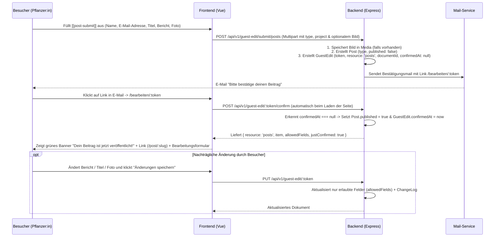

# Implementierungsvorschlag: Öffentlicher Pflanzblog & Generisches `GuestEdit`-Konzept

Dieses Dokument beschreibt das Konzept und die konkrete technische Umsetzung für das Einreichen, sofortige Bestätigen per E-Mail-Klick und nachträgliche Bearbeiten von Beiträgen (`Post`, z. B. mit `type: 'pflanzung'`) – basierend auf einer **vollständig nicht-invasiven, generischen `GuestEdit`-Architektur**, die ohne Schema-Änderungen an `Post` auskommt und auch für andere Entitäten (z. B. Bestellungen, Mitmach-Aktionen) genutzt werden kann.

---

## 1. Festgelegte Eckpunkte

- **Keine Schema-Änderung an `Post`:** Der Bestätigungsstatus wird komplett über `GuestEdit.confirmedAt` und das bestehende `Post.published`-Feld abgebildet.
- **Veröffentlichung:** Sofort nach Klick auf den Link in der Bestätigungs-E-Mail (`GuestEdit.confirmedAt = now`, `Post.published = true`).
- **Medien:** 1 Titelbild pro Beitrag per einfachem Datei-Upload (automatische Skalierung & Varianten-Generierung im Backend).
- **Frontend-Einbindung:** Über das Makro `[[post-submit]]` mit den Parametern `type` (Default: `'pflanzung'`) und `project` (optional), z. B. `[[post-submit type="pflanzung" project="klimabaumaktion-ulm"]]` – exakt analog zu `[[posts type="pflanzung"]]`.
- **Formular-Labels:** Schlichte Feldnamen ohne Possessivpronomen/Artikel (`Name`, `E-Mail-Adresse`, `Projekt`, `Titel`, `Foto`, `Bericht` – passend zu [post.json](file:///home/holger/jdevel/goplantatree/homepage/config/post.json) und [order.json](file:///home/holger/jdevel/goplantatree/homepage/config/order.json)).

---

## 2. Das generische `GuestEdit`-Konzept im Detail

### 2.1. Warum 0 Schema-Änderungen an `Post` (Option 1) ideal sind

- **100 % nicht-invasiv:** [Post.js](file:///home/holger/jdevel/goplantatree/homepage/backend/src/models/Post.js) bleibt unverändert. Unbestätigte Gast-Beiträge haben einfach `published: false` und werden dadurch automatisch von `crudFactory` bei allen öffentlichen `GET /api/v1/posts`-Aufrufen ausgefiltert.
- **Kein Leak-Risiko:** Weder das `token` noch die `email` des Gastes liegen im `Post`-Dokument – sie können niemals versehentlich über öffentliche Entity-Endpunkte ausgeliefert werden.
- **Eindeutiger Lebenszyklus über `GuestEdit.confirmedAt`:**
  1. **Eingereicht, wartet auf E-Mail-Klick:** `guestEdit.confirmedAt === null` und `post.published === false`
  2. **1. Klick auf den Link in der E-Mail:** Backend erkennt `guestEdit.confirmedAt === null` → setzt `guestEdit.confirmedAt = new Date()` und `post.published = true` (`justConfirmed: true`).
  3. **Spätere Aufrufe desselben Links:** `guestEdit.confirmedAt !== null` → der Gast kann den Beitrag bearbeiten oder ihn bei Bedarf selbst wieder depublizieren (`published: false`), ohne dass er beim nächsten Öffnen versehentlich wieder als „Erstbestätigung" behandelt wird.

### 2.2. Neues Modell: `GuestEdit` (`homepage/backend/src/models/GuestEdit.js`)

Speichert die Verknüpfung zwischen einem kryptografischen Token, der E-Mail-Adresse des Gastes und dem Ziel-Dokument:

```javascript
// homepage/backend/src/models/GuestEdit.js
import mongoose from 'mongoose';
import crypto from 'crypto';

const guestEditSchema = new mongoose.Schema({
    token: {
        type: String,
        unique: true,
        index: true,
        default: () => crypto.randomBytes(32).toString('hex')
    },
    resource: { type: String, required: true, index: true },    // z.B. 'posts', 'orders'
    documentId: { type: mongoose.Schema.Types.ObjectId, required: true, index: true },
    email: { type: String, required: true },                    // E-Mail des Erstellers
    project: { type: String, default: null },
    allowedFields: [{ type: String }],                          // Whitelist editierbarer Felder
    confirmedAt: { type: Date, default: null },                 // null = unbestätigt, Date = Zeitpunkt der Erstbestätigung
    lastUsedAt: { type: Date, default: null },                  // Letzte Bearbeitung
    expiresAt: { type: Date, default: null }                    // Optional: Ablaufdatum (null = dauerhaft gültig)
}, {
    timestamps: true
});

export default mongoose.model('GuestEdit', guestEditSchema);
```

---

## 3. Ablauf & API-Endpunkte (`/api/v1/guest-edit`)



### Die 3 Endpunkte in `homepage/backend/src/routes/guestEdit.js`:

1. **`POST /api/v1/guest-edit/submit/:resource`** (aktuell für `posts` konfiguriert, per Registry für weitere Ressourcen erweiterbar):
   - Rate-Limiting (max. 5 pro 15 Min. pro IP).
   - Prüft `email` (inkl. MX-Record-Check wie in [orders.js](file:///home/holger/jdevel/goplantatree/homepage/backend/src/routes/orders.js#L78-L93)).
   - Falls `req.file` (Bild) mitgeschickt wurde: legt ein `Media`-Dokument inkl. `thumb`/`small`/`medium`-Varianten an und setzt `data.image = media.slug`.
   - Bereinigt HTML in `content` (Schutz vor XSS) und erzeugt eindeutigen `slug` aus `title` (sowie `excerpt` automatisch aus `content`, falls leer).
   - Übernimmt `type` aus dem Request (validiert gegen `['news', 'artikel', 'pflanzung']`, Default: `'pflanzung'`) und speichert `Post` mit `{ type, published: false }`.
   - Erzeugt `GuestEdit` mit `allowedFields: ['title', 'content', 'excerpt', 'author', 'image', 'project', 'published']` (`type` ist nicht in `allowedFields`, damit der Gast den vom Makro vorgegebenen Typ nachträglich nicht verändern kann).
   - Versendet Bestätigungs-E-Mail (`MailTemplate` `slug: 'post-confirm'` oder eingebauter HTML-Fallback) mit Link `${siteUrl}/bearbeiten/${guestEdit.token}`.

2. **`POST /api/v1/guest-edit/:token/confirm`** (Laden & sofortiges Bestätigen beim Öffnen des Links):
   - Sucht `GuestEdit` per `token` (prüft optional `expiresAt`).
   - Lädt das zugehörige Dokument (`Post`).
   - **Sofort-Veröffentlichung beim 1. Klick:** Wenn `!guestEdit.confirmedAt`, wird `guestEdit.confirmedAt = new Date()` und `doc.published = true` gesetzt, beides gespeichert und im `ChangeLog` vermerkt (`justConfirmed = true`).
   - Gibt `{ resource, item, allowedFields, justConfirmed }` zurück.

3. **`PUT /api/v1/guest-edit/:token`** (Nachträgliches Bearbeiten & Bild ersetzen):
   - Nimmt Änderungen (optional inkl. neuem Bild-Upload via `multer`) entgegen.
   - Filtert alle Eingabefelder strikt gegen `guestEdit.allowedFields`.
   - Speichert das Dokument, aktualisiert `guestEdit.lastUsedAt` und schreibt einen Eintrag ins `ChangeLog` (`user: ` `guest:${guestEdit.email}`).

---

## 4. Frontend-Umsetzung

### 4.1. Makro `[[post-submit]]` (`MacroPostSubmit.vue`)
- Registriert in [macroRegistry.js](file:///home/holger/jdevel/goplantatree/homepage/frontend/src/utils/macroRegistry.js) und [DynamicContent.vue](file:///home/holger/jdevel/goplantatree/homepage/frontend/src/components/common/DynamicContent.vue):
  - **`type`**: `String` (Default: `'pflanzung'`, z. B. `'pflanzung'`, `'artikel'` oder `'news'`) – bestimmt den `type` des erstellten `Post`-Eintrags, damit er automatisch in der passenden `[[posts type="..."]]`-Liste erscheint.
  - **`project`**: `String` (Default: `''`, optional, z. B. `'klimabaumaktion-ulm'`) – legt das Projekt fest (falls leer, kann der Gast optional ein Projekt auswählen).
  - **`buttonLabel`**: `String` (optional, Default je nach `type`: z. B. `'🌱 Pflanzbericht einreichen'` bei `pflanzung`, sonst `'✍️ Beitrag einreichen'`).
  - Beispiel: `[[post-submit type="pflanzung" project="klimabaumaktion-ulm"]]`
- **UI & Feldnamen (ohne Artikel/Possessivpronomen):**
  - Einladender Button (`buttonLabel`), der beim Klick das Formular aufklappt:
    - **Name** (`author`, Pflichtfeld)
    - **E-Mail-Adresse** (`email`, Pflichtfeld – mit Hinweis: *„Wird nicht veröffentlicht. Du erhältst einen Bestätigungs- und Bearbeitungslink per E-Mail."*)
    - **Projekt** (`project`, Auswahl, falls nicht durch Makro-Prop `project` fest vorgegeben)
    - **Titel** (`title`, Pflichtfeld)
    - **Foto** (`file`, 1 Bild-Datei auswählen mit lokaler Bildvorschau)
    - **Bericht** (`content`, WYSIWYG-Editor via `RichTextEditor.vue`)
  - Nach dem Absenden: Bestätigungsmeldung *„Bitte prüfe dein E-Mail-Postfach und klicke auf den Bestätigungslink – damit geht dein Beitrag sofort online!"*

### 4.2. Generische Gast-Bearbeitungsseite (`/bearbeiten/:token` → `GuestEditPage.vue`)
- Route in [router/index.js](file:///home/holger/jdevel/goplantatree/homepage/frontend/src/router/index.js):
  ```javascript
  {
      path: '/bearbeiten/:token',
      name: 'guest-edit',
      component: () => import('../pages/GuestEditPage.vue'),
      meta: { hero: true }
  }
  ```
- **Ablauf beim Öffnen:**
  1. Ruft `POST /api/v1/guest-edit/:token/confirm` auf.
  2. Zeigt oben ein Status-Banner:
     - Bei Erstklick (`justConfirmed: true`): **„🎉 E-Mail bestätigt! Der Beitrag ist jetzt veröffentlicht."** + direkter Button **„Beitrag im Blog ansehen →"** (`/post/:slug`).
     - Bei späterem Aufruf: **„✏️ Beitrag bearbeiten"** + Link zum veröffentlichten Beitrag.
  3. Darunter das vorausgefüllte Formular (mit denselben schlichten Feldnamen `Name`, `Projekt`, `Titel`, `Foto`, `Bericht`) zum Korrigieren sowie ein Toggle/Button, um den Beitrag bei Bedarf wieder zu depublizieren (`published: false`).

---

## 5. Übersicht der neuen / anzupassenden Dateien

| Datei | Änderung |
|---|---|
| `homepage/backend/src/models/GuestEdit.js` *(neu)* | Generisches Mongoose-Modell für Magic-Link-Tokens (`token`, `resource`, `documentId`, `email`, `allowedFields`, `confirmedAt`) |
| `homepage/backend/src/routes/guestEdit.js` *(neu)* | Endpunkte `POST /submit/:resource`, `POST /:token/confirm`, `PUT /:token` (inkl. Bild-Upload & Mail-Versand) |
| [server.js](file:///home/holger/jdevel/goplantatree/homepage/backend/server.js) | Route `/api/v1/guest-edit` + Rate-Limiter registrieren |
| `homepage/frontend/src/components/macros/MacroPostSubmit.vue` *(neu)* | Öffentliches Einreichungsformular (`[[post-submit type="pflanzung" project="..."]]`) |
| [DynamicContent.vue](file:///home/holger/jdevel/goplantatree/homepage/frontend/src/components/common/DynamicContent.vue) & [macroRegistry.js](file:///home/holger/jdevel/goplantatree/homepage/frontend/src/utils/macroRegistry.js) | Makro `post-submit` registrieren |
| `homepage/frontend/src/pages/GuestEditPage.vue` *(neu)* & [router/index.js](file:///home/holger/jdevel/goplantatree/homepage/frontend/src/router/index.js) | Öffentliche Seite `/bearbeiten/:token` für sofortige Bestätigung & nachträgliche Bearbeitung |
